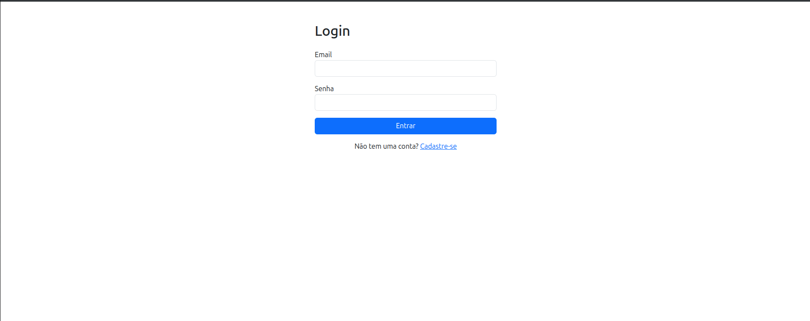
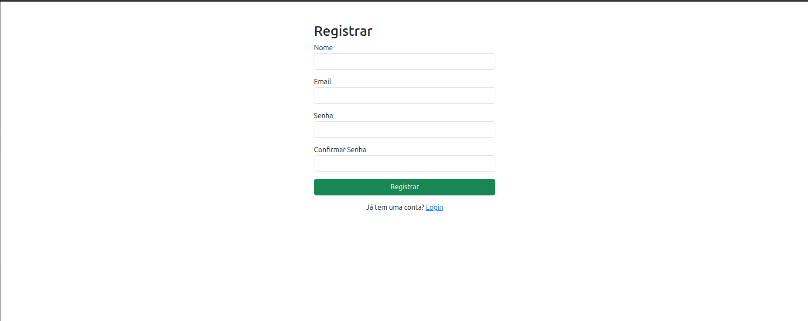
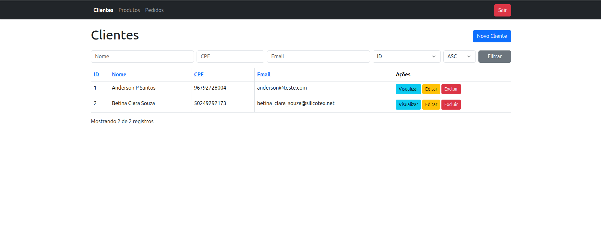
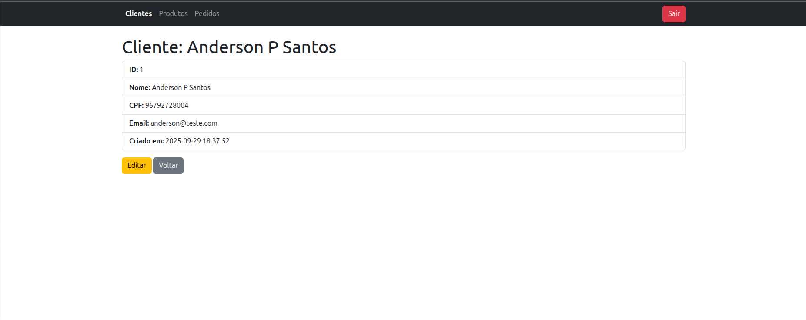
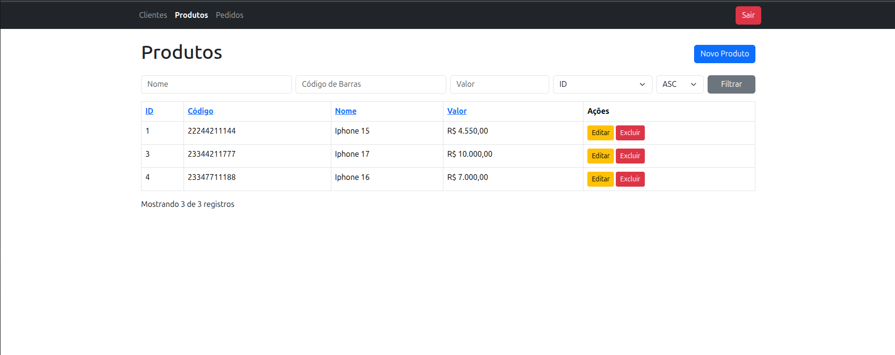
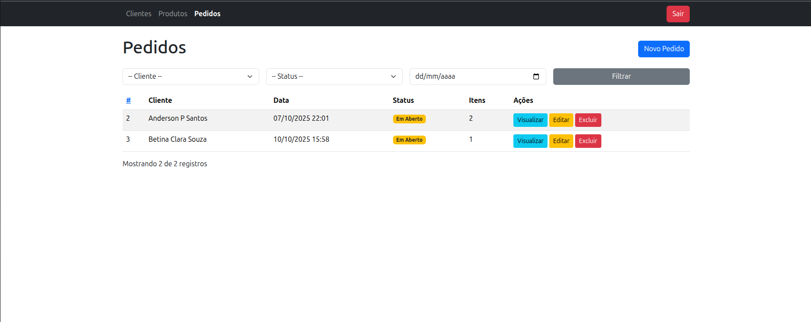
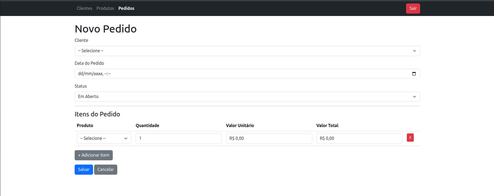
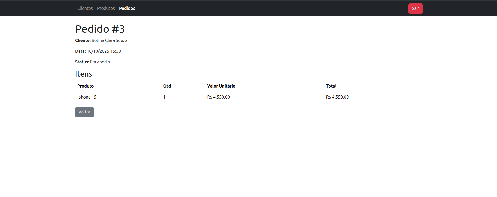

# 🛒 Sistema de Gestão (Clientes, Produtos e Pedidos)

Este é um projeto desenvolvido em **Laravel 12** como parte de um processo seletivo.  
O sistema tem como objetivo gerenciar **clientes, produtos e pedidos**, com autenticação de usuários.

<h1 align="center"></h1>
<h1 align="center"></h1>
<h1 align="center"></h1>

<h1 align="center"></h1>
<h1 align="center"></h1>

<h1 align="center"></h1>
<h1 align="center"></h1>
<h1 align="center"></h1>


## 🚀 Funcionalidades

- Autenticação de usuários (login, registro e logout)
- CRUD completo de **Clientes**
- CRUD completo de **Produtos**
- CRUD completo de **Pedidos**
- Validações com **Form Requests**
- Layout simples utilizando **Bootstrap 5**
- Navbar dinâmica exibindo links conforme autenticação
- Mensagens de sucesso/erro após as operações

---

## 🛠️ Tecnologias utilizadas

- **[Laravel 12](https://laravel.com/)**
- **PHP 8.2+**
- **MySQL 8**
- **Composer** para gerenciamento de dependências
- **Bootstrap 5** para estilização
- **Blade** para renderização das views
- **Docker** para ambiente de desenvolvimento

---

## ⚙️ Como rodar o projeto

### 1. Clone o repositório
```bash
git clone git@github.com:AAndersonSantos/testePHP.git
cd seu-repositorio
```

### 2. Copie o arquivo .env.example para .env e configure suas variáveis de ambiente:
```bash
cp .env.example .env
```

### 3. Suba os containers:
```bash
docker-compose up -d --build
```

### 4. Instale as dependências PHP dentro do container:
```bash
docker exec -it nome-do-container-app composer install
```

### 5. Gere a chave da aplicação Laravel:

Esse comando gera uma chave de criptografia única para a sua aplicação Laravel e a armazena no arquivo de configuração de ambiente .env.

```bash
docker exec -it nome-do-container-app php artisan key:generate
```

### O que acontece?

- O Laravel cria uma chave aleatória e segura, no formato Base64.

- Essa chave é salva na variável APP_KEY dentro do arquivo .env.

- Exemplo de como ficará no .env:
```env
APP_KEY=base64:testetesteKZDP0hIMDOo6nSK5Ho+u88c+W+0xPjGUKV4=
```

### Por que isso é importante?

- Essa chave é usada para criptografar dados sensíveis da aplicação, como sessões e cookies.

- **Sem essa chave**, a criptografia do Laravel não funciona corretamente e a aplicação pode apresentar erros de segurança e autenticação.

- A chave deve ser única para cada ambiente e não deve ser alterada após a aplicação estar em uso, para evitar problemas com dados criptografados.

### 6. Rode as migrations:
```bash
docker exec -it nome-do-container-app php artisan migrate
```

### 7. Acesse no navegador:
```arduino
http://localhost:8000
```